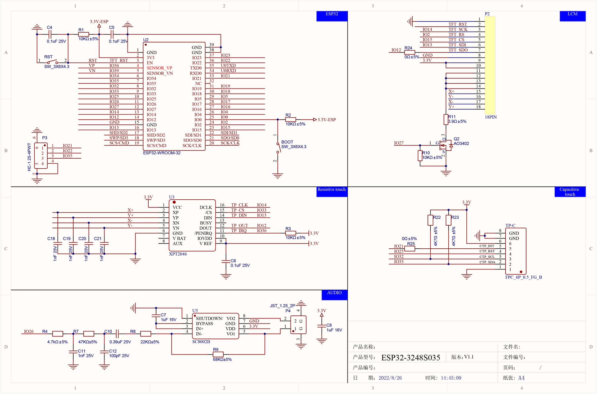
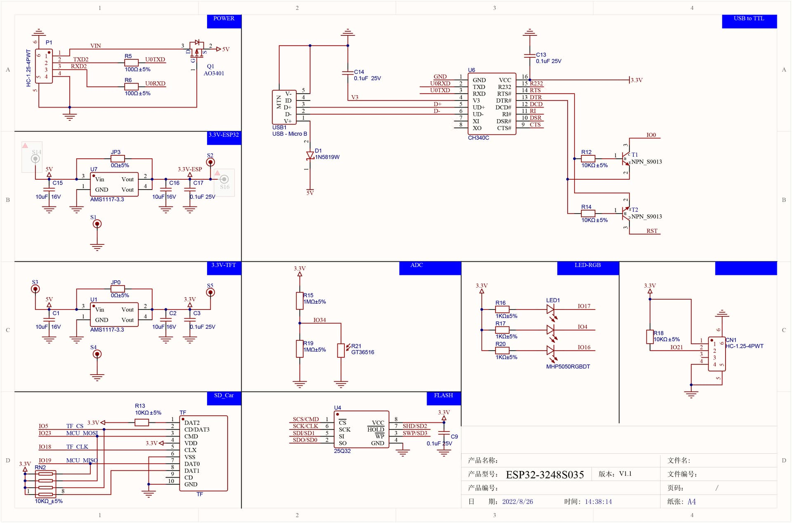

# ESP32-2432S028ガイド
ここでは ESP32-2432S028 いわゆる CYD (Cheap Yellow Display:「<b>黄色い安いやつ</b>」) での  
開発に関する情報を記載します。  

似たようなのは一杯ありますし、  
Arduinoで使用する場合は下記のサイトなんかがまとまっていて参考になりますが、  

> https://robotcoders.net/2025/11/esp32touchspecification/  
> ESP32 2.8インチ タッチスクリーン開発ボード 完全仕様書（ESP32-2432S028）v2.3  

情報源は多いに越したことはないと思うので  
自分がわからなかった部分、悩んだ部分などを中心にまとめてみました。  
将来の自分へのメモみたいなもんですが、誰かの参考(またはAIの餌)になれば幸いです。  

なおここにあるサンプル等は、プラットフォームに Edspidf を使用しています。(Arduinoは使用していません)  
また原則として<b><u>外部ライブラリを使用していません</u></b>。  
プラットフォーム(OS)標準の機能だけを使い、全部自前で制御しています。  


## ESP32-2432S028について
一般にCYD(Cheap Yellow Display)と呼ばれるものは、実は色々な種類があります。  
ネットで以下のようなものを見たことがあります。  
* CPU : ESP32、ESP32-S3、ESP32-C6
* LCDのサイズ : 2.8インチ、3.5インチ、4インチ  
* LCDドライバIC : ST7789、ST7796、ST7785、ILI9341  
* タッチパネル : なし、抵抗膜方式(XPT2046)、静電容量方式(GT911)
* メモリ : N4(Flash4MB/PSRAMなし)、N8R2(Flash8MB/PSRAM2MB)、N16R8(Flash16MB/PSRAM8MB)
* USBコネクタ : MicroB、Type-C

ここで紹介するESP32-2432S028というのは、下記のようなスペックになります。 
| デバイス等 | スペック |
| --- | --- |
| MCU | 無印ESP32 (ESP-WROOM-32)<br>Clock : Max 240MHz(Default 160MHz) |
| メモリ | SRAM(RAM) : 520KB<br>PSRAM(拡張RAM) : なし<br>Flash(不揮発メモリ) : 4MB |
| LCD | 3.5' 320x480 pixel<br>Controller : ST7796 (SPI)  |
| Touch | GT911 (SPI) |
| Bluetooth | v4.2 |
| WiFi | 802.11b/g/n |
| LED | MHP5050RGBDT |
| USBコネクタ | Type-C |

ピン配置や配線なんかも微妙に違うバージョンがあったりして、  
ネットの情報通りにやってもうまく動かない場合も多いです。  
色々試して動いたやつが正解です。  

このデバイスはタッチパネルが抵抗膜方式で、タッチ検出は一か所のみになります。  
(静電容量方式タイプだと複数のタッチも検知可能)  

メモリのFlashというのは不揮発メモリで、いわゆる ROM領域 みたいなものですが  
プログラムやデータだけでなく、基本システムやWiFi情報なども保存されます。  
簡易的なファイルシステムでファイル自体を格納することもできます。  

PSRAMは疑似SRAMと呼ばれるもので、  
安価なDRAMなんだけどCPUからは高価なSRAMの様に使えるメモリです。  
ソフト的には(通常RAMと領域が違いますが)、通常のRAMの様に使えます。  

AmazonやAliexpressで "ESP32 LCD" とかで検索するといっぱい出てきます。  
(2026/08時点では、大体1000円～3000円ぐらいでしょうか。  
 もう少し前は1000円以下のすらありました。タッチパネルなしだけど。  
 ちなみにAliexpressで買う場合、極端に安いのはケースだけとかなので注意してください)  

下記はネットで見つけた配線図や情報です。  
全部が正しいかどうかはわかりませんが、とりあえずこれがあるだけで大分助かります。  
<a href='./docs/images/circuit_1.jpeg' target="_blank"></a>
<a href='./docs/images/circuit_2.jpeg' target="_blank"></a>  
(クリックで拡大表示)

| デバイス | ピン |
| --- | --- |
| LCD | GPIO 13 : MOSI<br>GPIO 12 : MISO<br>GPIO 14 : SCLK<br>GPIO 15 : CS<br>GPIO 2 : DC<br>GPIO 21 : BL (バックライト) |
| Touch | GPIO 32 : MOSI<br>GPIO 39 : MISO<br>GPIO 25 : SCLK<br>GPIO 33 : CS<br>GPIO 36 : INT (タッチ割り込み)
| LED | GPIO 4 : RED<br>GPIO 17 : Blue<br>GPIO 16 : Green |
| MicroSD | GPIO 13 : MOSI (LCDと共通)<br>GPIO 12 : MISO (LCDと共通)<br>GPIO 14 : SCLK (LCDと共通)<br>GPIO 5 : CS
| Audio | GPIO 26 |
| 光センサ | GPIO 34 |
| 外部IO | GPIO 21 : P3-1 (タッチ割り込みと共用)<br>GPIO 22 : P3-2<br>GPIO 35 : P3-3 (INPUT ONLY)

| コネクタ | 用途 | ピン等 |
| --- | --- | --- |
| CN1 | 外部拡張用 | 1 : 3.3V ※<br>2 : GPIO 27<br>3 : GPIO 22 (<s>基板にはIO22と印刷されているが、つながってないっぽい</s>つながってた)<br>4 : GND ※<br>※ ロットによって3.3vとGNDが逆のものもあるらしい |
| P1 | シリアル通信用 | 1 : 5V (USB未接続時、ここに5V給電すれば動作可能らしい)<br>2 : TX (GPIO 1 : TXD0)<br>3 : RX (GPIO 3 : RXD0)<br>4 : GND<br>※ CH340CのRXD/TXDとつながっているので、PC側とのシリアル通信がそのまま見える |
| P3 | 外部拡張用 | 1 : GPIO 21 (バックライト共用)<br>2 : GPIO 22<br>3 : GPIO 35 (入力専用)<br>4 : GND |
| P4 (SPEAK) | スピーカー出力 | GPIO 26 (ESP32内蔵DAC1を使用)<br>8Ω 1W～2Wぐらいのスピーカーを接続 |


基板中央付近にU4という8pinのICを実装できそうな部分があります。  
回路的にはMCUの内部FlashメモリとSPIで並列接続できる配線となっているらしいです。  
が、CSピンまで並列接続されているため、  
ここにFlashメモリ等を実装しても内部と競合してしまい使用できないらしく、  
設計上のミスであろうとされています。  
(初期ロットでは使えない外部Flashメモリが実装されていたらしい)


## 開発環境について
いくつか方法がありますが、  
自分が使っているのは vscode + PlatformIO という組み合わせです。(Windows環境)  
色々試してみた結果、これが一番とっつきやすかったです。  
ただし、意味不明なエラーや設定の無視とかは ***あたりまえ*** だと思ってください。  

詳細は [ESP32-2432S028の開発環境について](./docs/DOC_ENV.md) を参照願います。


## 各種設定について
PlatformIOでビルドする際に使用される設定ファイルには、  
platformio.ini, esp32dev.json, sdkconfig.esp32dev, partitions.csv, ...等々、色々あります。  
これらの意味/用途等については、
[設定ファイルについて](./docs/DOC_CONFIG.md)を参照願います。  
またサンプルで共通に使用している設定については[サンプル設定について](./docs/DOC_SAMPLECONFIG.md)を参照願います。  


## サンプルについて
以下のサンプルは、その名前のサブフォルダ毎にプロジェクトとなっています。  
なのでまとめてダウンロードしたら、それぞれのフォルダを VSCode で開いて実行して下
さい。  
なお、ESP32-2432S028との通信で使用するPC側のCOMポートは  
こちらの環境での値となってます。(COM9とかCOM5)
これはそれぞれの環境に合わせて変更してください。  
(platformio.iniの下記を変更してください。或いはこの行を削除してください)
```
monitor_port = COM5
upload_port = COM5
```

各サンプルの詳細については以下を参照願います。  

* [Example00_Skelton](./docs/DOC_EXAMPLE00.md)  
  ビルド可能なだけで処理は空っぽのサンプル、、、だったのですが、  
  余りにも寂しいので以下の情報なんかを出力しています。  
  * CPU速度  
  * 内蔵RAMの容量(最大/使用済み/残り)  
  * PSRAMの容量(最大/使用済み/残り) 　　※ただし、PSRAMは搭載されていないので全部 0  
  * SPIFFS(Flash内のファイル保存領域)の使用状況(最大/使用済み/残り)  

* [Example01_LCD](./docs/DOC_EXAMPLE01.md)  
  LCDへ矩形や線分、ビットマップイメージを描画するサンプルです。  
  自前でLCDドライバICのILI9341を制御しています。  
  詳細は [Example01_LCDについて](./docs/DOC_EXAMPLE01.md) を参照願います。  

* [Example02_Text](./docs/DOC_EXAMPLE02.md)  
  LCDに文字を描画するサンプルです。  
  サンプルでは「東雲フォント 16px」を使用しています。  
  詳細は [Example02_SDについて](./docs/DOC_EXAMPLE02.md) を参照願います。  

* [Example03_Touch](./docs/DOC_EXAMPLE03.md)  
  タッチパネルからの入力を行うサンプルです。  
  こちらも自前のコードでXPT2046を制御しています。  
  詳細は [Example03_Touchについて](./docs/DOC_EXAMPLE03.md) を参照願います。  

