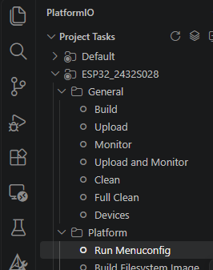
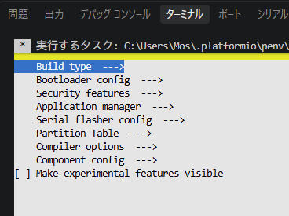

# 各種設定について

## 設定ファイル
PlatformIOでビルドする際に使用される設定ファイルには下記があります。  
(ESP32系をビルドするときに使用されるファイル類)  

| 種別 | 具体的なファイル名 | 内容・用途等 |
| --- | --- | --- |
| プロジェクト構成ファイル | platformio.ini | プロジェクト全体の構成やビルド時の条件等を記載 |
| ボード定義ファイル | esp32dev.json等 | マイコンのクロック周波数やメモリ容量などを定義 |
| システム構成ファイル | sdkconfig.defaultsや<br>sdkconfig.環境名 | マイコン等の挙動を定義 |
| パーティションテーブル設定ファイル | partitions.csv | Flash領域の定義 |
| ビルド構成ファイル | CMakeLists.txt | リンクするライブラリ等の情報 |

これらの繋がりについて自分が認識している内容を書いておきます。  


## プロジェクト構成ファイル ( platformio.ini )  
まず最も大切なのは、プロジェクトフォルダのルートにある platformio.ini です。  
このファイルで指定された内容を元に参照するファイル等が決定されます。  

ESP32用のプロジェクトを生成した直後では下記の様になっているかと思います。  
(「;」で始まるコメント行は除外)
``` platformio.ini
[env:esp32dev]
platform = espressif32
board = esp32dev
framework = espidf
```

順に説明します。  


## '[env:環境名]'行
``` platformio.ini
[env:esp32dev]
```
この行は「環境名」の宣言で、これ以降はesp32devという環境の定義だよ、という意味になります。  

環境名自体はある程度自由に決めて問題ありません。  
複数を登録して、微妙にビルドオプションを変えるなんてこともできます。  

``` platformio.ini
[env]
platform = espressif32
board = esp32dev
framework = espidf

[env:esp32dev_debug]
build_flags = -D"MYDEBUG"

[env:esp32dev_release]
build_flags = -D"MYRELEASE"
```
上記の場合は、「esp32dev_debug」と「esp32dev_release」という環境が定義されています。  
(esp32dev_debugでビルドした場合はマクロ MYDEBUG が定義されており、  
 esp32dev_releaseでビルドした場合はマクロ MYRELEASE が定義された状態でビルドされます)  

一番上の名前なしのenv定義は、両方に共通の定義となります。  

env:の後ろで指定される環境名は、  
システム構成ファイル(sdkconfig.構成名)のピリオド以降に使用されます。  
上記設定の場合、「sdkconfig.esp32dev_debug」と「sdkconfig.esp32dev_release」が 
生成されることになります。


## 'platform ='行
```
platform = espressif32
```
この行では対象のプラットフォームを指定しています。  
上記では espressif32プラットフォーム でビルドするという意味になります。  
つまりこの行の指定により、使用されるコンパイラ等が選択される訳です。  

より具体的には、 C:\User\(ユーザ名)\\.platformio\platforms 下にある  
ツールとかデフォルト設定が使われることを意味します。

ESP32の場合は espressif32 ですので C:\User\(ユーザ名)\\.platformio\platforms\espressif32 以下が使われますし、  
Arduinoの場合 atmelavr になりますので C:\User\(ユーザ名)\\.platformio\platforms\atmelavr 以下が使われます。


## 'board ='行
```
board = esp32dev
```
この行ではビルド対象のマイコン情報(正確には使用するボード定義ファイルのファイル名)を指定しています。  

上記の場合、C:\Users\(ユーザ)\.platformio\platforms\espressif32\boards\\<u>esp32dev.json</u> が使われるということになります。  

なお、プロジェクトフォルダ下の boards フォルダにあるものが優先されます。  
(ここにコピーしておけば、アップデートとかで変更されても影響を受けなくなります。たぶん)  


## 'framework ='行
```
framework = espidf
```
この行では使用するフレームワークを指定しています。  

ここに指定できるのは、  
C:\Users\(ユーザ)\.platformio\platforms\espressif32\platform.json  
のframeworksというノードに登録されているもので  
上記の <u>espidf</u> を指定した場合、platform.jsonの定義により、ビルドは  
C:\Users\(ユーザ)\.platformio\platforms\espressif32\builder\frameworks\\<u>espidf.py</u>
が使用されることになります。  


## その他の設定項目
上記以外でよく使う設定項目について説明します。

```
upload_port = COM9
```
上記は実機が接続されているCOMポート(書き込み先のCOMポート)を指定します。  
PCに１台しかつながっておらず、COMポートも１つしかない場合は勝手に見つけてくるので不要ですが、  
色々つなげていると自動では明後日のCOMポートに書き込もうとする場合もあるので必要になります。  

```
monitor_port = COM9
monitor_speed = 115200
```
シリアルモニターで使用するCOMポート、及び、通信速度を指定します。  
COMポートの方は書込と同様に要らない場合が多いですが、  
通信速度は指定した方がいいです。  
(実機側のデフォルトが115200で、シリアルモニターのデフォルトが9600なので不一致となります)  　　

```
build_flags = -I"${PROJECT_DIR}/../Include"
```
buikd_flagsではコンパイル時のオプションを指定できます。  
"-I"では追加のインクルードファイルのパス指定、  
"-D"ではマクロの定義などが指定できます。  


## システム構成ファイル(sdkconfig.*)について
このシステム構成ファイルの仕組みが一番難解というか正解が見えませんでした。  
とりあえず自分の認識を残しておきます。  

まず、ビルドに実際に使用されるシステム構成ファイルは sdkconfig.環境名 です。  
(デフォルトだと sdkconfig.esp32dev とか)  
このファイルの内容で挙動が決定されます。  

なのでこのファイルを直接書き換えれば間違いないのですが、  
設定項目が膨大にあって書き換えは難しいです。  

PlatformIOメニューの [Project Tasks] - [環境] - [Platform]にある  
[Run Menuconfig]を選択すると、設定画面が表示されます。  

 



注意! ターミナルの領域が小さいと表示されません。  
コード領域を減らしてターミナル領域を増やすか、大きいモニタを買ってください。

ここでCPU速度とか選択してもいいのですが、毎回やるのは面倒です。  
そこで必要な部分のみ書き換える仕組みが用意されています。  
それが差分ファイル(sdkconfig.defaults)です。  

「sdkconfig.defaults」があると、  
「sdkconfig.環境名」を作るとき(プロジェクトが作られる時とか、platformio.iniを書き換えて保存した時)に
デフォルトの設定に「sdkconfig.defaults」の内容を上書きして「「sdkconfig.環境名」を作成してくれます。  
(存在しない場合デフォルトの設定で「sdkconfig.環境名」を作成してくれます)  

注意が必要なのは、すでに「sdkconfig.環境名」が存在すると、更新してくれない点です。  
(sdkconfig.defaultsに書き込んでも無視される)  
sdkconfig.defaultsを更新した場合は、かならず「sdkconfig.環境名」を削除してください。  
次回ビルドした時に自動的に「sdkconfig.defaults」の内容が反映された「sdkconfig.環境名」が作成されます。


## サンプルのビルド設定
上記をプロジェクト作成毎に色々設定するのが面倒なので、  
自分は自動的に自分好みの設定に書き換えるスクリプトを用意して使ってます。  

サンプルでは全てこの設定を使用しています。  
詳細は[サンプル設定について](./DOC_SAMPLECONFIG.md)を参照ください。  
