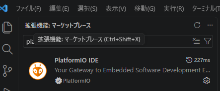
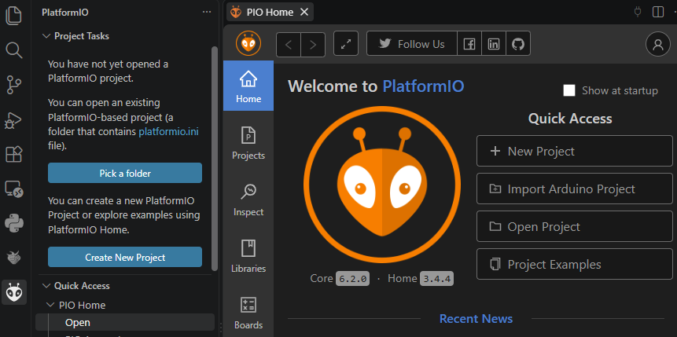
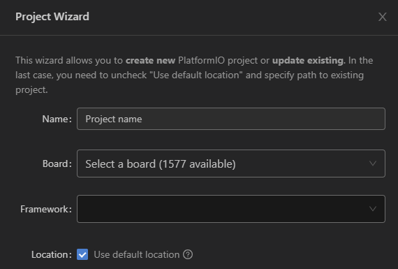
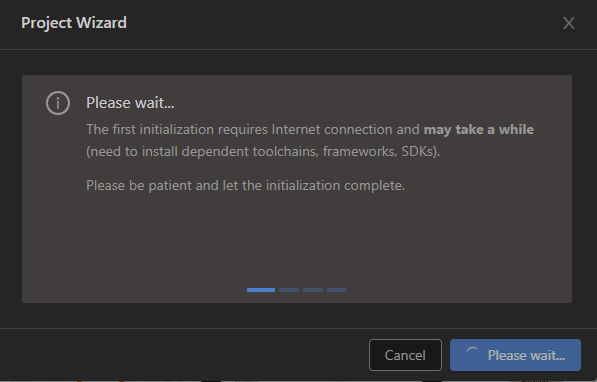
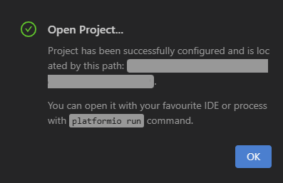
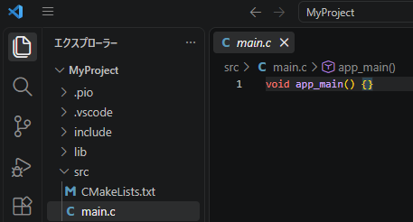
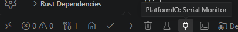
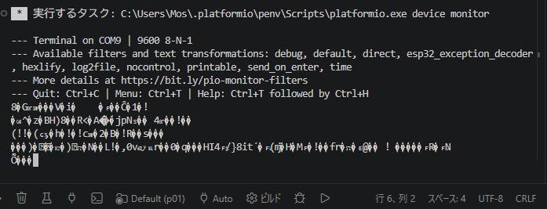
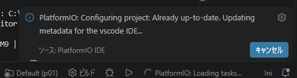

# ESP32-2432S028の開発環境について

ここでは ESP32-2432S028 の開発環境として  
    
    Visual Studio Code (VSCode)  +  PlatformIO  

という開発環境について記載します。


## インストール

インストール方法は、、、申し訳ありませんが、入れるだけです。  
VSCodeは「vscode インストール」とかでググれば、親切丁寧なサイトに招待してもらえます。  

PlatformIO(VSCodeの拡張機能)は、  
VSCodeを起動して Ctrl+Shift+X を押して「platformio」って検索欄に入れて、  
リストに出てきた↓アリンコマークのやつをインストールするだけです。  
※ 人によってはエイリアンに見えるらしい。Apache Ant由来。


実は VSCode も PlatformIO も結構バージョンアップがあって、  
困ったことに設定画面やら項目やら表記やらがコロコロ変わってるんです。  
古い情報は逆に混乱するので、毎回素直に調べた方が確実です。  


## プロジェクト作成
PlatformIO拡張機能をインストールすると、デフォルトで毎回下記の PIO Home が表示されます。  
[Show at startup]のチェックを外すと出てこなくなります。  

出したいときは左端のアリンコマーク(下記画像の左下)をクリックし  
表示される PlatformIOメニュー(下記画像のProject TasksとかQuick Acceessとかある部分) から  
[Quick Access] - [PIO Home] - [Open]をクリックすると、  
PIO Home画面(下記画像のでっかいアリンコマークがあるタブ)が表示されます。  
(或いは[Create New Project]の部分のクリックでも表示されます)  
  

新しくプロジェクトを作る場合は、PIO Home画面の [New Project] をクリックし、  
表示される Project Wizrd画面(下記画像) で必要項目を入力/選択します。
  

ここで紹介しているやり方ですと、下記の様に選択します。  

```
  Name      : プロジェクトの名前(そのままフォルダ名になる)  

  Board     : "Espressif ESP32 Dev Module"を選択。 
              いっぱいあって探すの大変だけど、  
              Board欄に "esp32" とか入力するとフィルタされてちょっと楽。  

  Framework : "Espidf"を選択。
              ここで "Arduino" を選択すれば Arduino のプロジェクトになる。

  Location  : チェックすると (ドキュメント)\PlatformIO\Projects の下に作られる。
              チェックを外すと、好きな場所に作成できる。

```

上画像では見切れていますが、下部に [Finish] というボタンがあります。  
これをクリックすると下記の様な表示となりプロジェクトを作成し始めます。  


で、この時、ビルドに必要になるファイルとかをダウンロードしています。  
普通は数分程度で終わると思いますが、ネット環境によっては数十分かかる場合もあります。  
ゆっくり待ちましょう。(あるいはCancelして再度やってみて下さい)

なおPorxy環境の場合、ここで進まなくなる場合があります。（っていうか、なりました）  
自分の場合、VSCodeのProxy設定とWindowsの[システムのプロパティ] - [環境変数] に  
下記を登録したらうまくいきました。  

| 名称 | 値(環境に合わせて) |
|---|---|
| HTTP_PROXY | http://(プロキシのアドレス):(プロキシのポート番号) |
| HTTPS_PROXY | http://(プロキシのアドレス):(プロキシのポート番号) |

この辺も何が正解なのかわかりません。  
(ツールによってHTTPS_PROXYがない場合にHTTP_PROXYを使うものもあれば、  
 HTTPSしかダメなものもあるし、その逆もある。  
 色々なツールが使われるlinux起源のシステムとかだとほんとくたびれます)


で、うまくいくと下記の様なダイアログが表示されます。  
  

ここで [OK] を押すと、作成したプロジェクトが開き、、、ません。  
開く環境もあるようなのですが、私の環境ではエクスプローラで該当フォルダが開くだけです。  
開いたエクスプローラ上で右クリックメニューから「Codeで開く」を選択すれば開きます。  
あるいは、VSCodeを起動し メニュー[ファイル]-[フォルダを開く] で該当フォルダを選択し開きます。  

## コード編集及びビルド方法
PlatformIOでは、ソースは src フォルダ下に作成します。  

左端のアイコンが縦に並んでいる部分の一番上にある書類が重なっているアイコンをクリックし、  
ツリー表示されているエクスプローラーから src / main.c をクリックすると  
下記の様にソースファイルが編集できるようになります。  


プロジェクト作成直後は
``` c
void app_main() {}
```
の一行です。  
Espidfプラットフォームの場合、app_main()がユーザコードの開始位置となります。

これでもビルドに問題はないのですが、  
余りにもシンプルすぎるので、下記の様にします。

``` c
#include <stdio.h>

void app_main() 
{
    printf( "Hello\n" );
}
```

ビルドは Ctrl + alt + B で行えます。  
Arduino UNOなんかに比べるとめちぇくちゃ時間がかかります。  

エラーが無ければ ターミナル に下記の様な出力がされます。  
```
RAM:   [          ]   3.5% (used 11396 bytes from 327680 bytes)
Flash: [==        ]  17.2% (used 180601 bytes from 1048576 bytes)
Building .pio\build\esp32dev\firmware.bin with action:
 : (略)
Creating esp32 image...
Merged 2 ELF sections
Successfully created esp32 image.
================ [SUCCESS] Took 86.33 seconds ======================
 *  ターミナルはタスクで再利用されます、閉じるには任意のキーを押してください。
```

ビルドに成功したならば Ctrl + alt + U で書き込み(アップロード)を行います。  
実はビルド(Ctrl + alt + B)しないでアップロードした場合は自動的にビルドしてくれます。  
なので普段は Ctrl + alt + U だけで十分です。  
(ビルド通るかどうかの確認だけしたい場合なんかは Ctrl + alt + B しますけど)  

で、アップロードが成功すれば下記の様な出力となります。  
```
Compressed 181008 bytes to 98271...
Writing at 0x00010000... (16 %)
Writing at 0x0001c594... (33 %)
Writing at 0x000220dd... (50 %)
Writing at 0x00027cb5... (66 %)
Writing at 0x0002f806... (83 %)
Writing at 0x00035cfa... (100 %)
Wrote 181008 bytes (98271 compressed) at 0x00010000 in 2.6 seconds (effective 552.7 kbit/s)...
Hash of data verified.

Leaving...
Hard resetting via RTS pin...
=============== [SUCCESS] Took 11.01 seconds ===============
 *  ターミナルはタスクで再利用されます、閉じるには任意のキーを押してください。 
```

下記の様な出力となった場合は
```
A fatal error occurred: Could not open COM9, the port is busy or doesn't exist.
(could not open port 'COM9': PermissionError(13, 'アクセスが拒否されました。', None, 5))

*** [upload] Error 2
================ [FAILED] Took 6.12 seconds ================
```
大抵別のプログラムまたはターミナル等がCOMポートを使っています。  
そちらの通信を切ってからアップロードしてください。  
どれかわからない場合は、ケーブルを抜去->再接続が一番です。  
(TeraTermとか接続されると自動的にオープンする様なものもあるけど)

## 実行結果の確認(ログ確認)

実行結果の確認、というか、printf とか ESP_LOGx とかで出力した情報を確認するには  
シリアルモニターを使用します。  

シリアルモニターはVSCode画面下部にあるプラグアイコン 🔌 から起動できます。  


上記でビルドした状態でシリアルモニターを起動すると、  
下記の様な表示になるかと思います。(文字化け)  


これは、シリアルモニターのシリアル通信速度がデフォルト 9600[bps] ですが、  
ESP32でのprintf等の出力は、115200[bps] であるために文字化けとなっているのです。  
```
--- Terminal on COM9 | 9600 8-N-1
```
というところが現在の通信速度です。  

シリアルモニターの通信速度は platformio.ini ファイル内で指定します。  
プロジェクトを作った直後は下記の様になっていると思いますが、
``` platformio.ini
[env:esp32dev]
platform = espressif32
board = esp32dev
framework = espidf
```
ここに下記を追記します。
```
monitor_speed = 115200
```

platformio.iniを書き換えて保存すると、VSCode右下に下記の様な表示が現れると思います。  


<b><u>
ここで注意!!!  
このダイアログというかポップアップなメッセージが出ている時にビルドしてはいけません!!!
</u>
</b>

設定を色々試している時とか platformio.ini を書き換えてすぐビルド  
(Ctrl + S → Ctrl + Alt + U)とかやりがちですが、  
platformio.iniを保存してすぐにビルドすると、かなりの高確率でビルドが失敗します。  
しかも大概意味不明のエラーです。  

PlatformIO拡張機能では、プロジェクトをビルドする為の設定等を platformio.ini に記入しますが、  
これが更新されたとき、その構成に沿って各種設定ファイルや必要なファイルのダウンロード等を行っています。  
なので更新中にビルドなんかやっちゃうと、ファイルが完全には読み込めなくてビルドに失敗してしまうんです。  
私はこれに気付くのにえらい時間がかかりました。  

ということで、右下になんかメッセージが出ている場合は素直にその内容を読んで(無視しないで)、 
処理が終わるまで待ってビルドするようにしましょう。  

ちゃんと設定されていれば下記の様に文字化けされずに表示されると思います。
```
--- Terminal on COM9 | 115200 8-N-1
--- Available filters and text transformations: debug, default, direct, esp32_exception_decoder, hexlify, log2file, nocontrol, printable, send_on_enter, time
--- More details at https://bit.ly/pio-monitor-filters
--- Quit: Ctrl+C | Menu: Ctrl+T | Help: Ctrl+T followed by Ctrl+H
ets Jul 29 2019 12:21:46
(略)
I (269) main_task: Calling app_main()
Hello
I (269) main_task: Returned from app_main()
```
printf()での出力が開発PC側で見れるのはありがたいですね。


## その他
その他、自分が忘れない様にしておきたい点を列挙します。  

* VSCode も PlatformIO も、なんか挙動がおかしくなった場合は  
  アンインストールして再インストールしましょう。  
  これで治る場合も多いです。(正式な対応方法だったりします)  
<br>
* PlatformIO関連のファイルは C:\Users\(ユーザ)\.platformio\ 下にあります。  
  ESP32関係は C:\Users\Mos\.platformio\platforms\espressif32\ 下です。  
  フォルダとか削除すると勝手に作られますし、  
  必要があればネットからダウンロードしてくれるみたいです。  
  直接書き換えて戻せなくなった場合などは思い切って削除してみましょう。  
<br>
* ArduinoIDE や Visual Studioとか一般的なビルドツールでは、  
  ライブラリ等を共通のフォルダに格納し、各プロジェクトで共有する仕組みが多いですが、  
  PlatformIOではプロジェクト毎にライブラリを確保(ダウンロード)します。  
  これによってバージョンアップ等で古いプロジェクトがビルドできなくなるのを防げます。  
  ただしプロジェクト毎にライブラリがダウンロードされるのでストレージ容量を食います。  
  SSD容量をそれなりに(下手するとGB単位)食いますしバックアップも遅くなりますが、  
  いつでもビルドが成功する環境を残せるので自分的にはアリです。  

