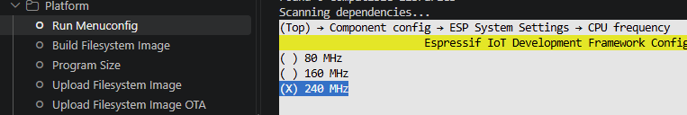

# Example00_LCD : スケルトンサンプル

## 概要
このサンプルは、ESP32-2432S028のビルドを確認するための(動作自体はあまり意味のない)サンプルです。

具体的には、実行すると下記の様な出力をシリアルに出力します。

```
---- Program Start ----
CPU Clock : 240 [MHz]
SRAM   : total =   381156, used =    76796, free =   304360
PSRAM  : total =        0, used =        0, free =        0
SPIFFS : total =  1860161, used =      502, free =  1859659
---- Program End ----
```

実行したときの、下記情報を出力します。  
```
    CPUクロック  
    RAMの総容量, 使用済み容量, 空き容量  
    PSRAMの総容量, 使用済み容量, 空き容量  
    SPIFFS領域の総容量, 使用済み容量, 空き容量  
```

ぶっちゃけこれだけでも出力できることを確認できれば、  
開発環境は整ったと考えられるでしょう。  


## CPU速度
ESP32はデフォルトでは 160MHz で動作しますが、  
設定を変更することで 240MHz で動作させることができます。  
(当然消費電力等が上がりますが)  

PlatformIOメニューから「Run Menuconfig」を選択し、  
　(Top) → Component config → ESP System Settings → CPU frequency  
を選択すると 80MHz / 160MHz / 240MHz の何れかから選択できます。  

  


或いは、「sdkconfig.defaults」に下記を追加し、
```
CONFIG_ESP_DEFAULT_CPU_FREQ_MHZ_240=y
CONFIG_ESP_DEFAULT_CPU_FREQ_MHZ=240
```
既存の「sdkconfig.環境名」を削除してビルドすれば有効になります。  

で、現在の設定は、実行時に esp_rom_get_cpu_ticks_per_us() で取得できます。  


## メモリ
ESP32でのメモリには、SRAM、フラッシュ(ROM)、PSRAM、などがあります。  
上記はかなり乱暴な分け方なのですが、まぁ、普通に使う分にはこれくらいの認識で十分です。  
(要は、自分がそれくらいの認識でとりあえず使えているということです)  

| 種別 | 意味・用途 |
| --- | --- |
| SRAM | 実行時のプログラムとデータを格納 |
| フラッシュ | 実行前のプログラムやデータを格納 |
| PSRAM | 拡張外部RAMで動的なデータを格納 |


## SRAM
(内蔵)SRAMは、実行時にプログラムやデータが置かれるメモリです。  
ESP32では プログラムコード用のIRAM と データ用の DRAM に分かれています。  

ESP32はROMに格納されたプログラムを直接実行することはできず、  
必要になったら動的にIRAM上に展開されて実行されます。  
普通はMMUが勝手にやってくれますのであまり意識する必要はありません。  
(割り込みハンドラとか関数単位に IRAM_ATTR を付けて常駐させるようにしたりします)  

データ用RAM(紛らわしいことにDRAMと呼ばれたりする)は、  
Espidfを使用する場合、最大で 300kb ぐらいで、連続領域では最大 170kb ぐらいです。  
サンプルでは heap_caps_get_total_size / heap_caps_get_free_size に
MALLOC_CAP_INTERNAL | MALLOC_CAP_8BIT を指定しています。  
これは内蔵SRAM中のデータ用RAMの領域を表します。  

スペック表なんかだと、ESP32の内蔵RAMは 520KB とか書かれることがありますが、  
上記のプログラム用のIRAMやらなにやらで使われるので、  
アプリから使えるのは上記ぐらいが限界です。  

## PSRAM

ESP32-2432S028にはPSRAMはありません。が、「ない」ということを確認するため、  
このサンプルでは有効にした上でサイズを取得して 0 であることを表示しています。  

カメラ付きのESP32モジュールとかだとPSRAMが大概入ってます。  

## フラッシュ

モジュールに刻印されている N4 とか N16R8 とかの記号で見極めることができます。  

| 記号 | 意味 |
| --- | --- |
| N4 | フラッシュ 4MB |
| N8R2 | フラッシュ 8MB、PSRAM 2MB |
| N8R16 | フラッシュ 8MB、PSRAM 16MB |

他にも N8 とか N16 とかもあるみたいです。

フラッシュは通常、領域で区切って領域ごとに使用します。  
その領域（パーティション）の使い方を定義しているのが「partitions.csv」になります。  
このファイル自体は「platformio.ini」の中で
```
board_build.partitions = partitions.csv
```
で指定されています。

このサンプルでは下記の様になってます。
```
# Name,   Type, SubType, Offset,  Size, Flags
nvs,      data, nvs,           ,   20K,
factory,  app,  factory,       , 2048K,
spiffs,   data, spiffs,        , 1984K,
```

Nameがプログラム等から指定する名前で、  
TypeとSubTypeでその使い方、  
OffsetとSizeで先頭位置とサイズ、  
Flagsで暗号化や読み込み専用などの属性を指定します。  

主に使用されるTypeとSubTypeは下記となります。

| Type | SubType | 用途・意味 |
| --- | --- | --- |
| app | factory | プログラム(工場出荷時の初期) |
| app | ota0<br>ota1 | OTAアップデート領域 |
| data | nvs | WiFiの設定等を格納 |
| data | otadata | OTA用の情報 |
| data | spiffs<br>fat<br>littlefs | ファイルシステム |
| data | coredump | コアダンプ格納用 |

通常、PlatformIO等から書込を行うとfactory領域にプログラムは格納されます。  
OTA(On The Air)を使う場合(WiFi経由でプログラムの書き換えを行う場合)は  
otaX領域とotadata領域が必要になります。  
(otaXにプログラムが格納され、otadataにどっちに入っているか等が入るらしい)

nvs領域にはWiFi関連の設定とかが格納されます。  
WiFiを使用しなくとも用意する必要があります。(無いとアプリが起動しません)  

spiffs領域は簡易的なファイルシステムを格納できます。  
プログラムからは一般的なfopen/fread/fwrite/fclose等の関数でファイルにアクセスできます。  

spiffs領域にファイルを書きこむには  
プロジェクトに data というフォルダを作成し、その中にファイルを入れ、  
PlatformIOのメニューツリーから[Platform] - [Upload Filesystem Image]を実行します。  
(fatとかもできるみたいですが、特にこだわりがなければspiffsでよいかと)  

