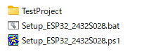
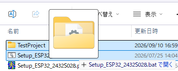
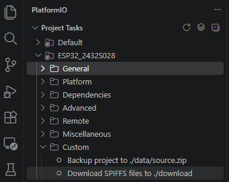

# サンプル設定について

## セットアップスクリプト
サンプルで共通で使用している設定は、  
Setup_ESP32_2432S028.ps1 及び Setup_ESP32_2432S028.bat で生成しています。  

正確には PlatformIO の Project Wizard で生成したプロジェクトを  
自分好みの設定に書き換えるスクリプトです。  
(Setup_ESP32_2432S028.batはSetup_ESP32_2432S028.ps1を呼び出すだけのものです。  
 ps1ファイルはファイルのドラッグアンドドロップに対応していないための処置です)  

 使い方は、作成したプロジェクトフォルダと同じ位置にこのファイルを置いて、  
 エクスプローラ等で対象のプロジェクトフォルダを Setup_ESP32_2432S028.bat にドロップしてください。
 
     
 (プロジェクトフォルダTestProjectをSetup_ESP32_2432S028.batにドロップ)

すると下記のような確認がありますので、  
```
実行プロファイル：C:\Users\Mos\Documents\WindowsPowerShell\Microsoft.PowerShell_profile.ps1

実行確認
下記フォルダのプロジェクトを CYD ESP32-2432S028 用に変更します。

D:\work\20260910_wk\TestProject

よろしいですか？
[Y] Yes  [N] No  [?] ヘルプ (既定値は "N"):
```
'y'を入力してください。すると、
```
セットアップ開始
[作成] D:\work\20260910_wk\TestProject/boards/ESP32-2432S028.json
[作成] D:\work\20260910_wk\TestProject/partitions.csv
[削除] D:\work\20260910_wk\TestProject/sdkconfig.*
[作成] D:\work\20260910_wk\TestProject/sdkconfig.defaults
[作成] D:\work\20260910_wk\TestProject/script_backup.py
[作成] D:\work\20260910_wk\TestProject/script_download.py
[更新] D:\work\20260910_wk\TestProject/platformio.ini
[作成] D:\work\20260910_wk\TestProject/src/main.cpp
[削除] D:\work\20260910_wk\TestProject/src/main.c
[削除] D:\work\20260910_wk\TestProject/.pio
[削除] D:\work\20260910_wk\TestProject/.vscode
完了
続行するには、Enter キーを押してください...:
```
という感じで更新されます。  
最後にEnterキーを押せば終了です。  

あとは対象のプロジェクトフォルダをVSCodeで開けばOKです。  


## 更新の内容

このスクリプトでは以下のことを行っています。  

① ボード定義ファイル(ESP32-2432S028.json)の作成  
② パーティション定義ファイル(partitions.csv)の作成  
③ システム構成ファイル用の差分ファイル(sdkconfig.defaults)作成  
④ spiffs用ツール(script_backup.py, script_download.py)の登録   
⑤ プロジェクト構成ファイル(platformio.ini)の更新  
⑥ メインソースファイル(main.cpp)作成  

---

### ① ボード定義ファイル(ESP32-2432S028.json)の作成  
デフォルトの C:\Users\(ユーザ)\.platformio\platforms\espressif32\boards にあるファイルではなく、  
プロジェクトフォルダ内の boardsフォルダ 下に、  
プロジェクト専用のボード定義ファイル(ESP32-2432S028.json)を生成します。  

こんな感じのシンプルなやつです。  
``` json
{
  "build": {
    "core": "esp32",
    "f_cpu": "240000000L",
    "f_flash": "40000000L",
    "flash_mode": "dio",
    "mcu": "esp32",
    "variant": "esp32"
  },
  "connectivity": [
    "wifi",
    "bluetooth"
  ],
  "frameworks": [
    "arduino",
    "espidf"
  ],
  "name": "ESP32-2432S028",
  "upload": {
    "flash_size": "4MB",
    "maximum_ram_size": 327680,
    "maximum_size": 4194304,
    "require_upload_port": true,
    "speed": 921600
  },
  "url": "https://example.com",
  "vendor": "Custom Vendor"
}
```
これだけあれば Espidf でのビルドに問題ありません。  

---

### ② パーティション定義ファイル(partitions.csv)の作成  
プロジェクトフォルダ下に下記のパーティション定義ファイル(partitions.csv)を出力します。  
```
# Name,   Type, SubType, Offset,  Size, Flags
nvs,      data, nvs,           ,   20K,
factory,  app,  factory,       , 2048K,
spiffs,   data, spiffs,        , 1984K,
```

この場合、下記の様なメモリマップとなります。  
```
# Flash内メモリ配置
# 00000000 - 00008FFF 00009000(  36K) システム領域:予約済み (ブートローダ等)
# 00009000 - 0000DFFF 00005000(  20K) nvs (システム設定等の保存)
# 0000E000 - 0000FFFF 00002000(   8K) otadata:予約済み (OTAデータ)
# 00010000 - 0020FFFF 00200000(2048K) app (プログラム格納先) 
# 00210000 - 003FFFFF 001F0000(1984K) SPIFFS (内蔵ファイルシステム)
# -----------------------------------------
#                       Total  4096K = 4MB
```
予約済みの所(システム領域とかotadata)は、サイズが固定です。  
この為、パーティション定義ファイルではその分を除いた合計を割り振ることになります。  

この設定は OTA(Over-The-Air) の利用を想定していません。  
(WiFi経由でプログラムを書き換える手段。  
 便利なんだけど、趣味の工作物ならケーブルでつなげばいいだけなんで使わない。  
 SPIFFS領域が減るし)  

---

### ③ システム構成ファイル用の差分ファイル(sdkconfig.defaults)作成  
プロジェクトフォルダ下に下記の差分ファイル(sdkconfig.defaults)を出力します。  
```
; PSRAM enable
CONFIG_SPIRAM=y
CONFIG_SPIRAM_IGNORE_NOTFOUND=y

; CPU speed
CONFIG_ESP_DEFAULT_CPU_FREQ_MHZ_240=y
CONFIG_ESP_DEFAULT_CPU_FREQ_MHZ=240
```

内容としては、PSRAM(外部RAM)の有効化とCPU速度の240MHz化を行うための設定になります。  

このファイルはデフォルトの設定から変更する内容のみを記述したファイルになります。  
なお当たり前ですが、PSRAMを有効にしても元々実装されていないならば増やしようがありません。  
(ESP32-2432S028にはPSRAMは搭載されていません)  


---

### ④ spiffs用ツール(script_backup.py, script_download.py)の登録   
このスクリプトでは以下のpythonプログラムファイルをプロジェクトに追加します。  

| ファイル名 | メニュー表記 | 内容 |
| --- | --- | --- |
| script_backup.py | Backup project to ./data/source.zip | ソースファイル一式を ./data/source.zip にバックアップする |
| script_download.py | Download SPIFFS files to ./dounload  | 実機のSPIFFS領域にあるファイルを ./download フォルダ下に格納する |

  
PlatformIOアイコン等からメニューツリーを表示して、  
[Project Tasks] - [(プロジェクト名)] - [Custom] 下に上記の項目が追加されます。  


script_backup.pyの方は、  
```
動いているプログラムのソースを実機に保存しておけば、  
ソースがどっかにいったり、どれだったかわからなくなることはない、かも
```
という誰もが一度は考えるであろうバックアップ手段を実現する為のものです。  
(実際には、ハードウェア障害時はやっぱり別途ソースバックアップが必要になるし、   
 書き換えに結構時間がかかるので毎回自動でやるわけにはいかず、  
 結局最後の保存をわすれてしまいがちなんですよね)  

実行すると プロジェクトフォルダルートにある data フォルダ内に  
ソースツリーの内容をzip圧縮した source.zip を格納します。  
この状態で、メニューツリー中の[Platform] - [Upload Filesystem Image]を実行すると、  
実機の SPIFFS領域 にソースのバックアップファイルが格納されます。  

<br>

script_download.pyの方は、  
上記で保存したソースをPC側に持ってくるためのものです。  
(こっちは全領域をダウンロードするんでさらに時間がかかります)  

実行すると 実機のSPIFFS内にあるファイルを  
プロジェクトフォルダルートにある data フォルダ内に ダウンロードします。  
SPIFFSにはプログラムからファイルを書くこともできるので、  
これで書き込んだデータの取り出しも楽にできます。


---

### ⑤ プロジェクト構成ファイル(platformio.ini)の更新  
全ての設定を取りまとめる platformio.ini を下記の様に書き換えます。  
``` platformio.ini
[env:ESP32_2432S028]
platform = espressif32
board = ESP32-2432S028
framework = espidf
monitor_speed = 115200
monitor_port = COM9
upload_port = COM9
board_build.partitions = partitions.csv
board_build.esp-idf.sdkconfig_defaults = sdkconfig.defaults
extra_scripts = script_backup.py, script_download.py
#build_flags = -I"${PROJECT_DIR}/../Include"
```

順に説明します。  

```
[env:ESP32_2432S028]
platform = espressif32
board = ESP32-2432S028
framework = espidf
```
この辺はデフォルトとほぼ同じです。  
環境名が exp32dev から ESP32_2432S028 に変更となり、  
ボード定義も標準の esp32dev から ESP32-2432S028 に変えています。  

ボード定義については、 ①でプロジェクト専用に作成したものを使用することになります。  
(./boards/ESP32-2432S028.jsonの設定が仕様されます)

フレームワークは無条件で espidf にしています。  
決してArduinoが嫌いなわけじゃないんですが、  
ESP32の場合、ベースで freeRTOS が動作しその上で Arduino が動作するので  
直接 freeRTOS を使う方が効率がいいと思ってしまうんです。  
(趣味の場合、外部ライブラリとか極力使わないようにしているので)  

```
monitor_speed = 115200
monitor_port = COM9
upload_port = COM9
```
この辺はデバッグ用のシリアルモニターの設定と、  
アップロード用のポートの指定になります。  

スクリプトの先頭部分にある下記の"COM9"の所を空白以外にすれば、  
そのポートを使用する様になります。  
``` ps1
###############################################################
# 定義
Set-Variable -Name PROJECT_TYPE -Value "CYD ESP32-2432S028" -Option Constant
Set-Variable -Name ENV_NAME -Value "ESP32_2432S028" -Option Constant
Set-Variable -Name BOARD_NAME -Value "ESP32-2432S028" -Option Constant
Set-Variable -Name COM_PORT -Value "COM9" -Option Constant # 空白時は指定なし
```

<br>

```
board_build.partitions = partitions.csv
```
上記でパーティション定義ファイルを指定しています。  
なお、ここもプロジェクトファイルに存在しない場合は、  
C:\Users\(ユーザ)\.platformio\packages\framework-espidf\components\partition_table  
あたりにあるファイルが使用されます。  


```
board_build.esp-idf.sdkconfig_defaults = sdkconfig.defaults
```
上記で、sdkconfig.環境名 を作成するときに使用される 差分ファイル を指定しています。  
デフォルトは sdkconfig.defaults らしいのですが、  ちゃんとしないと使ってくれません。  

---

### ⑥ メインソースファイル(main.cpp)作成  

一行だけだったソースファイルにかわり、  
メモリの使用状況等をシリアル出力するサンプルソースに置き換えます。  

一つ注意が必要なのは、PlatformIOで生成されたときのソースはC言語用(main.c)ですが、  
スクリプトではC++用ソース(main.cpp)になっています。  
仕事では問題の少ないC言語をよく使いますが、個人的にはベターCとしてC++をよく使います。  
サンプルでの各種クラスは、ヘッダーオンリーなソース構造にしています。  
(すいません、正直手抜きです)  

C++としてビルドされますのでクラス等が使える様になりますが、  
名前の解決には注意が必要になります。  
拡張子を　*.c　→　*.cpp　にしただけでは、多くの場合ビルドエラーとなります。  

Espidfプラットフォームで app_main() を呼び出す際、  
C言語のルール(ソース中の名前が正式名称)で呼び出します。  
しかしソースファイルを *.cpp にすると、  
app_main()を C++ のルール(引数や戻り値情報を加味した名前)でコンパイルしてしまい、  
「app_main()がないよ」というエラーになってしまいます。  
(void app_main() の名称が _Z8app_mainv の様な名前になってしまう)  

ユーザプログラムの開始位置である app_main() の名前解決ができる様にするため、  
extern句を付ける様にしてください。
``` c++
// ------------------------------------------------------------
// 開始
extern "C" void app_main()
{
    // 開始
    printf( "---- Program Start ----\n" );
    :
```

どう見たって存在する関数がないなんてエラーの時は、これが田院だったりします。  

